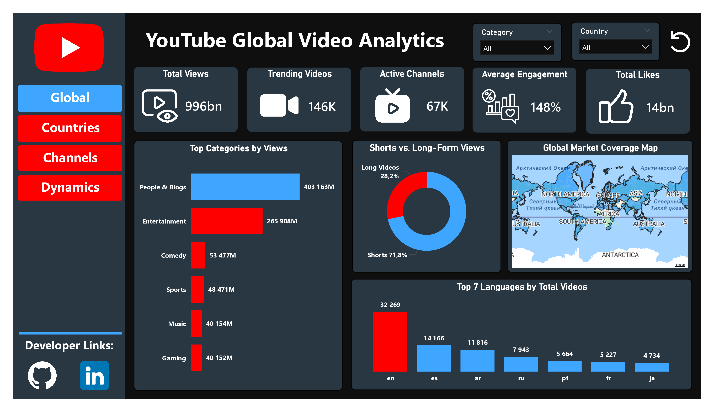
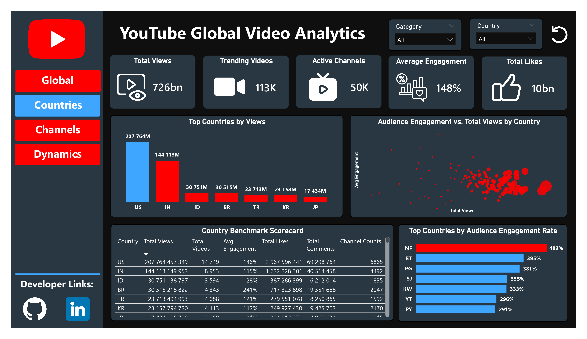
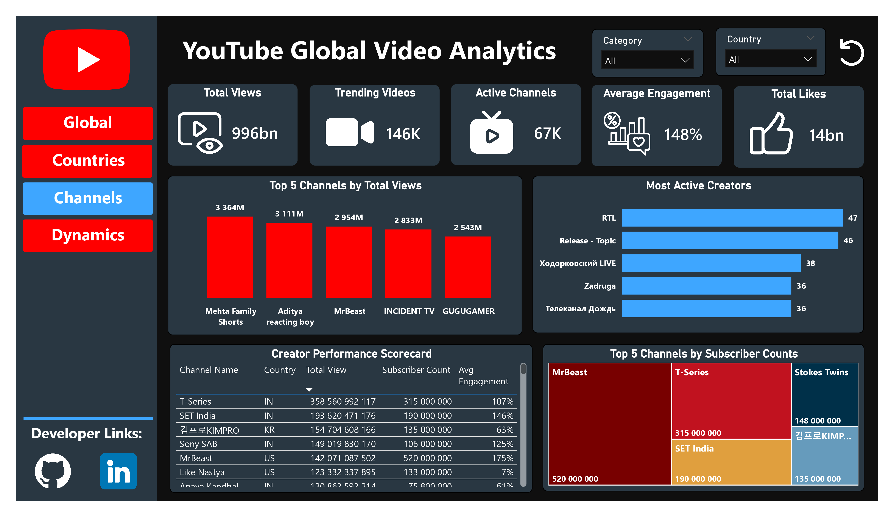
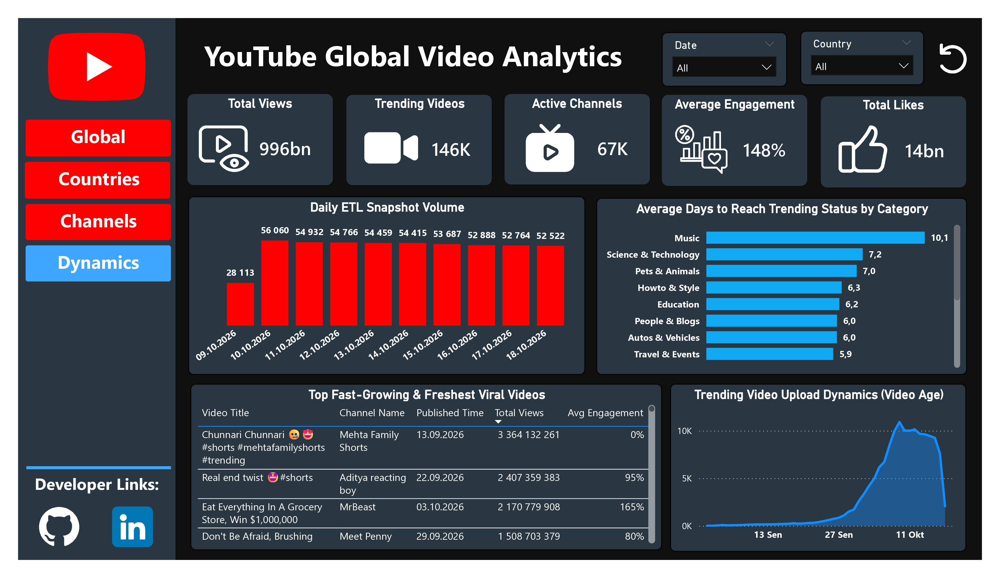
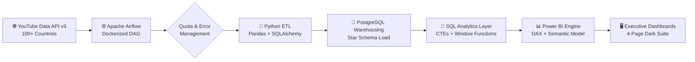

# 🎬 YouTube Global Trending Analytics & Virality Intelligence Pipeline

### *Automating Data Ingestion, Time-Series Modeling, and Executive BI Across 100+ Countries*


*An end-to-end Data Engineering & Analytics solution — from automated API ingestion orchestrated by Apache Airflow to a star-schema PostgreSQL warehouse and interactive Power BI executive suite — engineered to track, analyze, and predict global video virality dynamics.*

---

## 📌 Executive Summary

Digital media consumption moves at unprecedented speed, with YouTube trending algorithms serving as the ultimate barometer for global digital culture. However, raw trending endpoints present a major analytical challenge: they provide static point-in-time snapshots without historical persistence, making it difficult to measure video growth velocity, creator engagement efficiency, or regional format preference (Shorts vs. Long-Form).

The **YouTube Global Trending Analytics & Virality Intelligence Pipeline** is a fully automated, dockerized data pipeline operating across **100+ country codes**. Running continuously over a **10-day time-series window (Oct 09 – Oct 18, 2026)**, it captures daily performance snapshots to answer core digital strategy questions:

> **"Which video formats drive maximum engagement, how long do viral trends persist by category, and which creators exhibit peak growth velocity?"**

This project integrates four professional analytics layers:

| Layer | Tool / Technology | Core Purpose |
| --- | --- | --- |
| **1. Orchestration & Ingestion** | Apache Airflow + YouTube API v3 | Daily batch extraction, quota management, automated error handling (503 retries) |
| **2. Processing & Transformation** | Python (Pandas, SQLAlchemy) | Raw payload parsing, schema enforcement, date key formatting (`YYYYMMDD`) |
| **3. Warehouse & Querying** | PostgreSQL 15 + pgAdmin 4 | Star Schema modeling (`fact_video_performance`), advanced window functions & CTEs |
| **4. Business Intelligence** | Power BI + DAX | Star-schema semantic layer, 4 dark-themed executive reporting pages |

### 🔑 Headline Findings

* 📈 **Scale:** 146K trending videos, 67K active channels and ~996B total views analyzed across 100+ countries.
* 🩳 **Format split:** Shorts generate **715.5B views** vs. **280.9B** for Long-Form (71.8% share), but Long-Form converts better on likes (**2.30%** vs. **1.56%**).
* 🚀 **Growth velocity:** Top single-day spike of **+53.65M views** in 24 hours.
* 🎯 **Engagement:** Mid-tier creators reach up to **33.60%** engagement rate, far above large media outlets.
* ⏳ **Persistence:** **Music** stays longest on trending (4.7 days avg), **News & Politics** decays fastest (2.9 days).
* ⚡ **Speed to trend:** Top videos hit trending within **0–1 days** of upload.

---

## 🎨 Interactive Dashboard Preview

The Power BI report is organized into four purpose-built executive pages, hosted on Google Drive due to dataset volume.

### 🏠 Page 1: Global Market Overview



### 🌍 Page 2: Countries & Regional Benchmarking



### 📺 Page 3: Channels & Creator Analytics



### ⚡ Page 4: Dynamics & Virality Timing



---

## 🔄 End-to-End Data Pipeline

The pipeline follows an automated, idempotent **Extraction → Relational Star Schema → Business Intelligence** flow:



### Pipeline Stage Breakdown

| Stage | Description | Key Features |
| --- | --- | --- |
| **Orchestration** | Managed via Airflow DAG (`daily_youtube_quota_max_etl`) scheduled daily | API quota consumption cap (~5,200 units/run), automatic retry logic |
| **Ingestion** | Batch fetching trending lists across 100+ regional ISO codes | Multi-region payload parsing, channel/video metadata extraction |
| **Transformation** | Standardized language codes (`en-US` → `en`), format detection (`is_short`), date formatting | Pandas vectorized transformations, regex delimiter parsing |
| **Warehousing** | Daily snapshot upserts into PostgreSQL Star Schema | Foreign Key constraint enforcement, `date_key` integer surrogate keys |
| **Querying** | Advanced business analytics executed in PostgreSQL via pgAdmin 4 | CTEs, `LAG()` window functions, `TO_DATE(date_key::text, 'YYYYMMDD')` |
| **BI Reporting** | Imported into Power BI, modeled into 1:N Star Schema | Custom DAX measures, dynamic filtering, interactive dark UI |

---

## 📐 Database Schema & Data Modeling

The database is built around a **Star Schema** optimization for OLAP time-series performance, consisting of **one central Fact table** and **three core Dimension tables**.


### 📋 Table Reference

| Table | Type | Grain | Primary/Foreign Keys | Key Fields |
| --- | --- | --- | --- | --- |
| **`fact_video_performance`** | Fact | 1 row per video per daily snapshot | `video_id` (FK), `channel_id` (FK), `category_id` (FK) | `"views"`, `"likes"`, `"comments"`, `"date_key"` |
| **`dim_videos`** | Dimension | 1 row per unique video | `video_id` (PK) | `"title"`, `"published_at"`, `"language"`, `"is_short"` |
| **`dim_channels`** | Dimension | 1 row per creator channel | `channel_id` (PK) | `"channel_title"`, `"subscriber_count"`, `"country"` |
| **`dim_categories`** | Dimension | 1 row per content category | `category_id` (PK) | `"category_name"` |

**Why a Star Schema?**

* ✅ **Time-Series Efficiency:** Separates daily changing performance metrics (`views`, `likes`) from static attributes (`title`, `published_at`).
* ✅ **Preventing Double-Counting:** Enforces 1:N relationships between dimensions and fact rows.
* ✅ **Power BI VertiPaq Optimization:** Fast column-based compression and DAX filter propagation.

---

## 💡 Advanced SQL Analytics & Business Insights

All production queries are organized inside the [`sql/`](sql/) directory. Executed in PostgreSQL via pgAdmin 4, they leverage `date_key` casting (`YYYYMMDD`), window functions, and multi-table joins.

### 1️⃣ Daily View Growth Velocity (`sql/02_daily_view_growth_velocity.sql`)

**Technique:** CTE + `LAG() OVER (PARTITION BY video_id ORDER BY TO_DATE(date_key))` to calculate day-over-day view gains.

```sql
WITH daily_views AS (
    SELECT 
        f.video_id,
        v.title,
        TO_DATE(f.date_key::text, 'YYYYMMDD') AS date,
        f.views,
        LAG(f.views) OVER (PARTITION BY f.video_id ORDER BY TO_DATE(f.date_key::text, 'YYYYMMDD')) AS prev_day_views
    FROM fact_video_performance f
    JOIN dim_videos v ON f.video_id = v.video_id
)
SELECT 
    title,
    date,
    views AS current_views,
    prev_day_views,
    (views - prev_day_views) AS daily_view_gain
FROM daily_views
WHERE prev_day_views IS NOT NULL
ORDER BY daily_view_gain DESC
LIMIT 10;
```

**📊 Finding:** The top viral video achieved a single-day spike of **+53.65 Million views** within 24 hours (*¡No Tires Basura en Casa!* on Oct 15, 2026).

### 2️⃣ Creator Engagement Efficiency (`sql/03_creator_engagement_efficiency.sql`)

**Technique:** Aggregation with `NULLIF()` division to compute engagement rate percentage normalized by channel subscriber count.

```sql
SELECT 
    c.channel_title,
    c.country,
    c.subscriber_count,
    COUNT(DISTINCT f.video_id) AS total_trending_videos,
    ROUND(AVG(f.views), 0) AS avg_views,
    ROUND(AVG((f.likes + f.comments)::numeric / NULLIF(f.views, 0) * 100), 2) AS avg_engagement_rate_pct
FROM fact_video_performance f
JOIN dim_channels c ON f.channel_id = c.channel_id
WHERE c.subscriber_count >= 100000
GROUP BY c.channel_id, c.channel_title, c.country, c.subscriber_count
HAVING COUNT(DISTINCT f.video_id) >= 3
ORDER BY avg_engagement_rate_pct DESC
LIMIT 10;
```

**📊 Finding:** Mid-tier creators (e.g. *Waqar Bhinder Vlogs*, 463K subs) achieve up to **33.60% engagement efficiency**, vastly outperforming massive media outlets on audience interaction density.

### 3️⃣ Category Trending Persistence (`sql/04_category_trending_persistence.sql`)

**Technique:** Nested CTE grouping by `video_id` and `date_key` to measure longevity on trending charts.

```sql
WITH video_trending_days AS (
    SELECT 
        f.category_id,
        f.video_id,
        COUNT(DISTINCT f.date_key) AS days_in_trending
    FROM fact_video_performance f
    GROUP BY f.category_id, f.video_id
)
SELECT 
    cat.category_name,
    COUNT(vtd.video_id) AS total_videos,
    ROUND(AVG(vtd.days_in_trending), 1) AS avg_days_in_trending,
    MAX(vtd.days_in_trending) AS max_days_in_trending
FROM video_trending_days vtd
JOIN dim_categories cat ON vtd.category_id = cat.category_id
GROUP BY cat.category_name
ORDER BY avg_days_in_trending DESC;
```

**📊 Finding:** **Music** leads overall retention with an average of **4.7 days** on trending charts, whereas **News & Politics** decays fastest at **2.9 days**.

### 4️⃣ Shorts vs. Long-Form Format Benchmark (`sql/05_shorts_vs_longform_performance.sql`)

**Technique:** Conditional formatting flag (`is_short`) aggregation across 515K+ fact rows.

```sql
SELECT 
    CASE WHEN v.is_short THEN 'Shorts (<60s)' ELSE 'Long-Form Video' END AS content_format,
    COUNT(DISTINCT f.video_id) AS total_unique_videos,
    SUM(f.views) AS total_views,
    ROUND(AVG(f.views), 0) AS avg_views_per_snapshot,
    ROUND(AVG((f.likes::numeric / NULLIF(f.views, 0)) * 100), 2) AS avg_like_ratio_pct
FROM fact_video_performance f
JOIN dim_videos v ON f.video_id = v.video_id
GROUP BY v.is_short;
```

**📊 Finding:**

| Content Format | Unique Videos | Total Views | Avg. Views / Snapshot | Avg. Like Ratio |
| --- | --- | --- | --- | --- |
| **Shorts (<60s)** | 68,092 | **715,517,954,890** 🔴 | **2,811,841** 🔴 | 1.56% |
| **Long-Form Video** | 77,658 | 280,977,313,102 | 1,079,698 | **2.30%** 🟢 |

Shorts dominate total attention volume (715.5B views vs. 280.9B), while Long-Form videos maintain higher intent and like conversion rates (2.30% vs 1.56%).

### 5️⃣ Freshest Viral Videos in First 48 Hours (`sql/06_freshest_viral_videos_48h.sql`)

**Technique:** Date arithmetic subtracting `published_at::date` from `MIN(TO_DATE(date_key))`.

```sql
SELECT 
    v.title,
    c.channel_title,
    v.published_at::date AS publish_date,
    MIN(TO_DATE(f.date_key::text, 'YYYYMMDD')) AS first_trending_date,
    (MIN(TO_DATE(f.date_key::text, 'YYYYMMDD')) - v.published_at::date) AS days_to_trend,
    MAX(f.views) AS peak_views
FROM fact_video_performance f
JOIN dim_videos v ON f.video_id = v.video_id
JOIN dim_channels c ON f.channel_id = c.channel_id
GROUP BY v.video_id, v.title, c.channel_title, v.published_at
HAVING (MIN(TO_DATE(f.date_key::text, 'YYYYMMDD')) - v.published_at::date) <= 2
ORDER BY peak_views DESC
LIMIT 10;
```

**📊 Finding:** Top creators consistently hit trending algorithms within **0 to 1 days of upload**, led by *ARGEN* (*Mrbeast meet Sigma*) reaching **150.7M peak views** in under 24 hours.

---

## 🎯 Strategic Business Recommendations

| Insight | Recommendation |
| --- | --- |
| Shorts dominate total views (715.5B vs. 280.9B) | Use Shorts for **reach and discovery** |
| Long-Form has higher like ratio (2.30% vs. 1.56%) | Use Long-Form for **audience conversion and loyalty** |
| Mid-tier creators show up to 33.60% engagement | Prioritize **mid-tier creators** for high-interaction campaigns |
| Videos trend within 0–1 days of upload | Concentrate promotion in the **first 24–48 hours** after publishing |
| Music retains 4.7 days vs. News & Politics 2.9 days | Plan content cadence by **category lifespan** |

---

## 📊 Dashboard Architecture & Page Specs

### 🏠 Page 1 — Global Market Overview

> *Executive Summary of global video performance.*

* KPI Cards: Total Views (996bn), Trending Videos (146K), Active Channels (67K), Total Likes (14bn).
* Top Categories by Views (People & Blogs, Entertainment, Comedy).
* Shorts vs. Long-Form Distribution (71.8% Shorts share).
* Global Market Coverage Map & Top 7 Languages.

### 🌍 Page 2 — Countries & Regional Benchmarking

> *Geographical distribution and country-level comparison.*

* Top Countries by Views (US: 207B, IN: 144B, ID: 30B, BR: 30B).
* Audience Engagement vs. Total Views Scatter Plot.
* Top Countries by Audience Engagement Rate.
* Country Benchmark Scorecard Table.

### 📺 Page 3 — Channels & Creator Analytics

> *Creator benchmarking and subscriber performance.*

* Top 5 Channels by Total Views & Subscriber Counts (MrBeast, T-Series, SET India).
* Creator Performance Scorecard Table with engagement metrics.
* Most Active Creators analysis.

### ⚡ Page 4 — Dynamics & Virality Timing

> *ETL health monitoring and time-series decay analysis.*

* Daily ETL Snapshot Volume (~52K–56K rows/day across 10 days).
* Average Days to Reach Trending Status by Category.
* Freshest Viral Videos Scorecard (First 48h performance).

---

## 📂 Repository Structure

```
youtube-global-analytics/
│
├── dags/
│   └── youtube_dag.py                      # Airflow ETL DAG definition
│
├── sql/
│   ├── 01_cleanup_unused_categories.sql     # Unused dimension cleanup
│   ├── 02_daily_view_growth_velocity.sql    # Day-over-day view gains CTE
│   ├── 03_creator_engagement_efficiency.sql # Subscriber normalized engagement
│   ├── 04_category_trending_persistence.sql # Longevity analysis by category
│   ├── 05_shorts_vs_longform_performance.sql# Format performance benchmark
│   └── 06_freshest_viral_videos_48h.sql     # First 48h virality query
│
├── power_bi/
│   └── README.md                           # Google Drive download link for .pbix
│
├── images/
│   ├── page1_overview.png                  # Global Overview screenshot
│   ├── page2_countries.png                 # Countries dashboard screenshot
│   ├── page3_channels.png                  # Channels dashboard screenshot
│   ├── page4_dynamics.png                  # Dynamics dashboard screenshot
│   └── postgresql_erd.png                  # Star Schema ERD diagram
│
├── .env.example                            # Environment configuration template
├── .gitignore                              # Git exclusion rules
├── requirements.txt                        # Python dependencies
└── README.md                               # Main project documentation
```

---

## 🚀 Reproduction & Setup Guide

### ✅ Prerequisites

* Python 3.10+
* Docker & Docker Compose
* PostgreSQL 14+
* Power BI Desktop

### Step 1 — Clone the Repository

```bash
git clone https://github.com/nihatrzaguluzada/youtube-global-analytics.git
cd youtube-global-analytics
```

### Step 2 — Configure Environment Variables

Create a `.env` file from the template:

```bash
cp .env.example .env
```

Populate `.env` with your YouTube Data API v3 key and PostgreSQL credentials.

### Step 3 — Launch Airflow & Infrastructure

```bash
docker-compose up -d
```

Access Airflow UI at `http://localhost:8080` and trigger `daily_youtube_quota_max_etl`.

### Step 4 — Run SQL Analytics

Connect to PostgreSQL via pgAdmin 4 or `psql` and execute the scripts in `sql/` sequentially.

### Step 5 — Download Power BI Report

Download the interactive `.pbix` file directly from Google Drive:

* 🔗 **[Download YouTube_Global_Analytics.pbix](https://drive.google.com/file/d/13dEOH-2RTNItvcZkrUIAeQqXyCiNsqTQ/view?usp=sharing)**

---

## 👤 Author

**Nihat Rzaguluzada**

*Data Analyst & Data Engineering Enthusiast*
